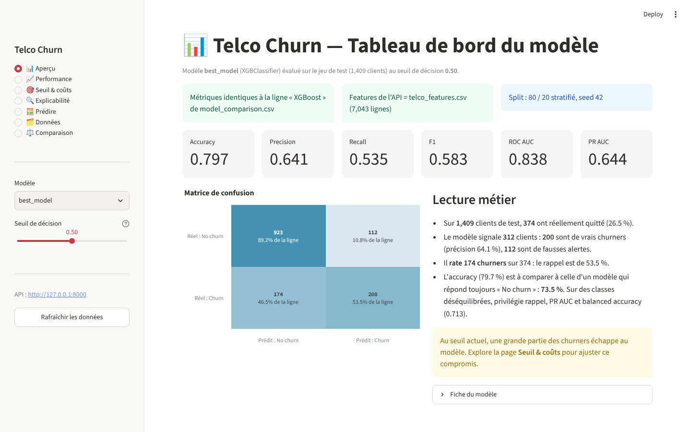
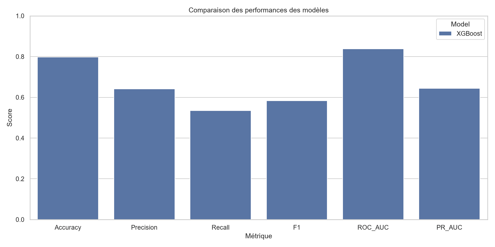
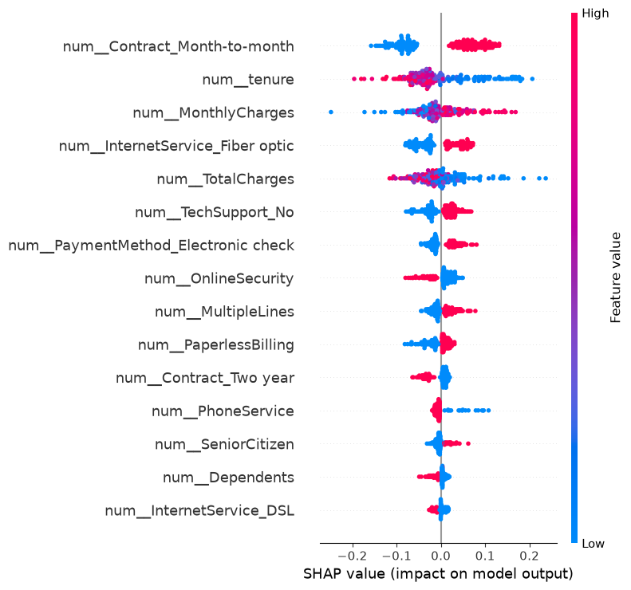
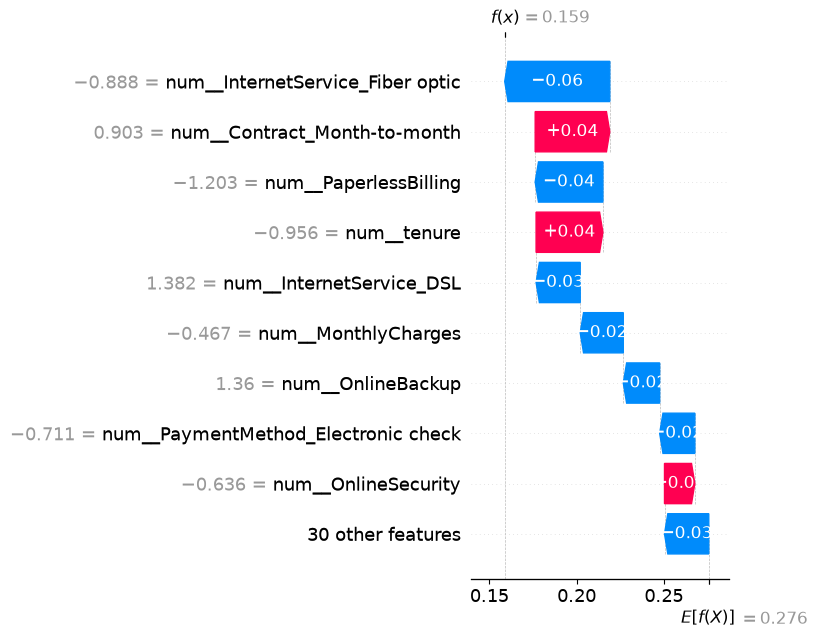
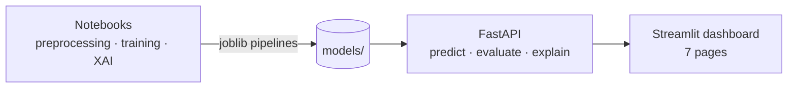
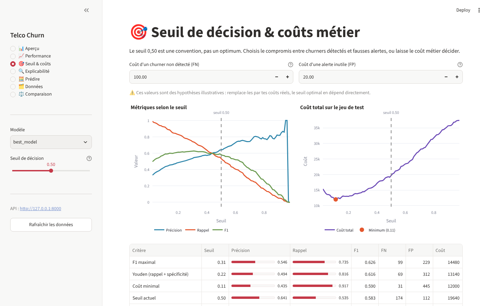
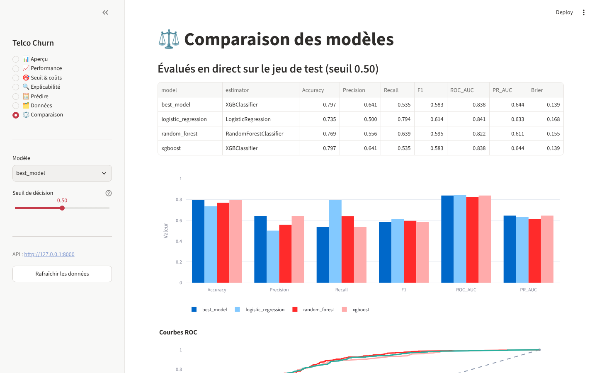
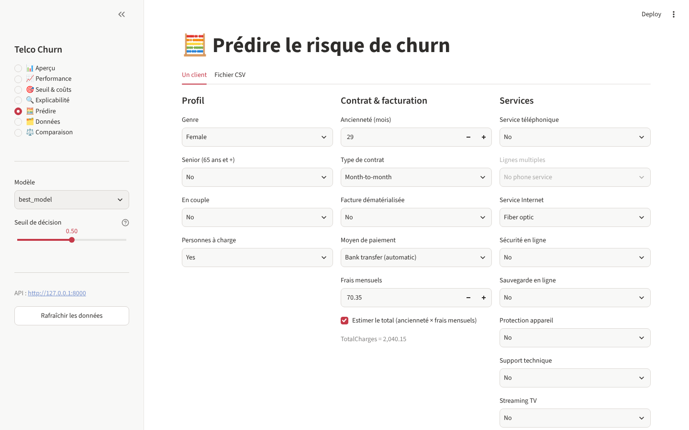

# Telco Churn — Prediction API & Model Evaluation Dashboard

> Predict which telecom customers are about to leave, explain **why** with SHAP and LIME, and let a business user pick the decision threshold that minimises cost — through a FastAPI service and a 7-page Streamlit dashboard.




## Results

IBM Telco Customer Churn dataset — 7,043 customers, 26.5 % churners. Test-set scores:

| Model | ROC-AUC | PR-AUC | Recall | Precision | F1 |
|---|---|---|---|---|---|
| **XGBoost** (deployed) | 0.838 | **0.644** | 0.53 | 0.64 | 0.58 |
| Logistic Regression | **0.841** | 0.633 | **0.79** | 0.50 | **0.61** |
| Random Forest | 0.822 | 0.611 | 0.64 | 0.56 | 0.60 |

Because missing a churner costs more than a retention offer, the dashboard lets the user move the threshold and see the recall / precision / cost trade-off instead of relying on the default 0.5.



## Explainability

Global and per-customer explanations with **SHAP** (summary, waterfall, dependence plots) and **LIME** The most influential factors are a month-to-month contract, tenure, monthly charges and fiber-optic internet.

<p align="center">
  
  
</p>

## Architecture



**API endpoints** (`/docs` for Swagger): `POST /predict`, `POST /predict/batch`, `GET /evaluation/metrics`, `/evaluation/curves`, `/evaluation/threshold`, `/evaluation/compare`, `GET /explain/global`, `/explain/dependence`, `GET /models`, `/data/overview`.

**Dashboard pages**: Overview · Performance · Threshold & cost · Explainability · Predict (single customer form or CSV batch) · Data · Model comparison.

Any new model saved as a `.joblib` pipeline in `machine_learning/models/` is picked up automatically and appears in the comparison page.

## Screenshots

| Threshold & cost tuning | Model comparison |
|---|---|
|  |  |

| Single-customer prediction |
|---|
|  |

## Getting started

```bash
git clone https://github.com/eya-dl/Tel_Churn.git
cd Tel_Churn

# Option 1 — Docker
docker compose up --build
# API: http://localhost:8000/docs   Dashboard: http://localhost:8501

# Option 2 — local
pip install -r requirements.txt
uvicorn backend.main:app --reload       # terminal 1
streamlit run frontend/app.py           # terminal 2
```

Point the dashboard to another API with `CHURN_API_URL=http://host:8000`.

## Project structure

```
backend/
  main.py       FastAPI routes
  service.py    model loading, feature engineering, metrics, SHAP
  schemas.py    input validation (Pydantic)
frontend/app.py Streamlit dashboard
machine_learning/
  preprocessing.ipynb · training.ipynb · xai.ipynb · visualisation.ipynb
  models/       trained pipelines (LR, RF, XGBoost)
  reports/      metrics, plots, SHAP/LIME outputs
```

## Author

**Eya Dhambri** — AI engineering student at ENSI (Tunisia) · [LinkedIn](https://www.linkedin.com/in/eya-dhambri) · eya.dhambri@ensi-uma.tn
